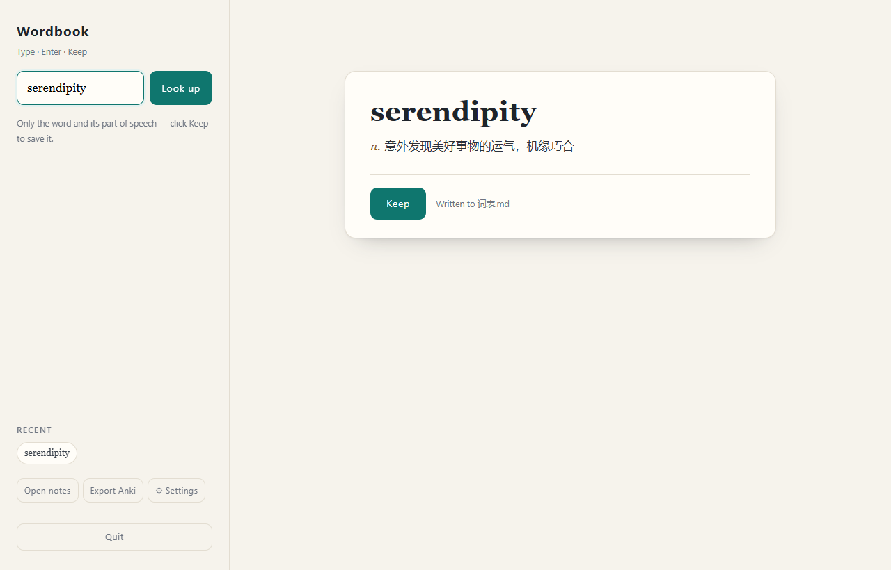
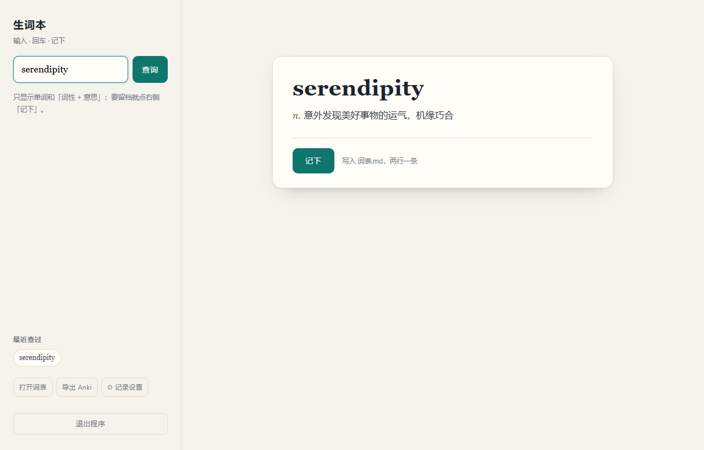

# Wordbook · 生词本

**A local-first English → Chinese vocabulary notebook for Windows. Two lines per word, written straight into a Markdown file on your desktop.**

*一个只跑在本机的极简生词本：左边查词，右边两行，点「记下」就写进桌面的 Markdown 文件。*

[简体中文](README.md) | **English**

[](https://github.com/MSaknussemm/wordbook/actions/workflows/ci.yml)
[](LICENSE)
[](https://www.python.org/)
[](#requirements)

| English UI | 中文界面 |
|---|---|
|  |  |

---

## Why

Vocabulary apps are heavy. Dictionary tools either only do pop-up translation or push you into a cloud account. What I wanted was narrow:

- Look a word up while reading;
- Click once to keep it, and it becomes one entry in `词表.md`;
- Don't click, and it leaves no trace.

No account, no sync, no spaced repetition, no recommendations. Just a lookup box and a Markdown file.

> The interface is Chinese-first. The code, tests and this document are readable without Chinese; only the bundled launcher scripts and UI strings are in Chinese.

## Features

| | |
|---|---|
| **Two lines, by default** | Word on line one, part of speech + meaning on line two. Phonetics and examples stay hidden unless you ask |
| **Bilingual UI** | Switch between Follow system / 中文 / English in settings; the **labels inside the Markdown file** follow too |
| **Two dictionary sources** | Youdao (Chinese) first, falling back to Wiktionary (English) when it fails or misses the word |
| **Configurable entries** | Three presets (minimal / study card / everything), per-field checkboxes, or a `{{word}} {{pos}} {{zh}} …` template |
| **Deduplicated** | A word is only recorded once |
| **Undo** | Undo the last entry — and it *refuses* if you edited the file afterwards, rather than truncating your data |
| **Portable output** | Anki CSV export (two columns, UTF-8 BOM so Excel is happy) |
| **No console window** | Launched through `pythonw` in the background |
| **Self-terminating** | Closes itself ~15 s after you close the tab; no orphan processes |
| **Local-only** | Binds `127.0.0.1` exclusively; POST endpoints validate `Host` / `Origin` / `Sec-Fetch-Site` against cross-site and DNS-rebinding attacks |

## Requirements

- **Windows 10 / 11** — uses `winreg`, `SO_EXCLUSIVEADDRUSE`, VBS and PowerShell. Not portable as-is.
- **Python 3.10+** — uses `dict[str, ...]` and `str | None`.
- **No `pip install`** — standard library only. This is a hard constraint of the project.

## Quick start

```powershell
git clone https://github.com/MSaknussemm/wordbook.git
cd wordbook
```

1. Put the folder anywhere (e.g. `C:\生词本`)
2. Right-click `启动词本.vbs` → **Send to** → **Desktop (create shortcut)**
3. Optional: right-click the shortcut → Properties → Change Icon → pick `生词本.ico`
4. Double-click the desktop icon — your browser opens by itself

Entries are written to `Desktop\词表.md` by default. To change that:

```powershell
python wordbook.py --file "D:\notes\my-words.md"
```

The file name is configurable but the UI strings are Chinese; if you want an English UI you'll need to translate `index.html`.

## Usage

| Action | |
|---|---|
| `Enter` | Look up |
| `Ctrl + D` | Save the current word |
| `↑` / `↓` | Cycle through recent lookups (when the input is not focused) |
| `Esc` | Clear the input |
| `⚙` | Entry settings: fields, template and **interface language** |
| `撤销上一条` | Undo the last saved entry |
| `打开词表` | Open the Markdown file |
| `导出 Anki` | Download the CSV |

## What an entry looks like

Default — two lines:

```markdown
## serendipity
n. 意外发现美好事物的运气，机缘巧合
```

With the "study card" preset:

```markdown
## ephemeral
adj. 短暂的；（主指植物）短生的，短命的；n. 只生存一天的事物；短生植物
- **音标**：UK /ɪˈfemərəl/ · US /ɪˈfemərəl/
- **例句**：
  - He talked about the country's ephemeral unity being shattered by the defeat.
    - 他谈到战败彻底粉碎了国家的短暂统一。
```

Custom template placeholders: `{{word}} {{pos}} {{zh}} {{en}} {{phonetic}} {{examples}} {{forms}} {{exam}} {{web}} {{time}}`.
Whitespace inside braces is fine (`{{ word }}`). A `## word` heading is added automatically if your template omits it — deduplication and export rely on it.

## Runtime files

| Path | Purpose |
|---|---|
| `Desktop\词表.md` | Your word list (plain text) |
| `%LOCALAPPDATA%\Wordbook\config.json` | Entry settings (fields / template) |
| `%LOCALAPPDATA%\Wordbook\port.txt` | The port actually in use |

Delete `config.json` to restore the defaults.

## How it runs

```
shortcut
  → 启动词本.vbs reads port.txt
  → if no live instance: pythonw wordbook.py --no-browser
  → backend binds a port and writes it back to port.txt
  → launcher verifies the `app` field on /api/ping, then opens the browser
  → the page holds an SSE connection plus a 20 s heartbeat
  → tab closed for 15 s / heartbeat idle 90 s / nobody connected for 60 s → exit
```

Why three signals instead of "exit when the tab closes":

- `pagehide` alone is killed by **F5** (refresh fires it too);
- heartbeats alone are killed by **background throttling** (timers drop to once a minute);
- SSE alone is fooled by **half-open connections** (Wi-Fi drops, the server still thinks someone is there).

So SSE decides "fast", heartbeats decide "slow", and a startup grace period covers "nobody ever came". The watchdog also detects a clock jump over 10 s and treats it as "just woke from sleep", so closing the lid no longer kills the service.

## Security

- Binds `127.0.0.1` only — not reachable from the LAN or the internet
- POST endpoints validate `Sec-Fetch-Site` and `Origin`, and pin `Host` to `127.0.0.1:<port>` / `localhost:<port>` (blocks DNS rebinding)
- The listener uses `SO_EXCLUSIVEADDRUSE`, so a second instance fails to bind
- The frontend never assembles HTML from dictionary data (`textContent` only)
- CSV export prefixes cells starting with `= + - @` with `'` to prevent formula injection
- Undo verifies both the file length and the trailing bytes before truncating

See [SECURITY.md](SECURITY.md).

## Dictionary sources & disclaimer

- Youdao's `dict.youdao.com/jsonapi_s` is an **unofficial** public endpoint with no SLA. It may change or disappear at any time. Keep request rates low; personal study use only.
- The English fallback is [dictionaryapi.dev](https://dictionaryapi.dev) (Wiktionary, CC BY-SA).
- This project **ships no dictionary data**; definitions are fetched at query time. Your word list never leaves your machine.
- Not affiliated with either service. For a stable Chinese source, plug in an official API.

## Development

```powershell
python -m unittest discover -s tests -v   # 26 offline tests
python wordbook.py --version
```

Coverage: input validation, Markdown generation (field toggles / templates / multi-POS), CSV export and injection guards, the three-way undo check, `Host`/`Origin` decisions, port probing and exclusive binding.

CI runs Python 3.10 / 3.11 / 3.12 on `windows-latest`. See [CONTRIBUTING.md](CONTRIBUTING.md) before opening a PR.

## Known limitations

- **Windows only.** Cross-platform support would require rewriting the launcher and the port-exclusivity logic.
- **Depends on an unofficial endpoint**; when it breaks, the fallback is English-only.
- `pick_port` only scans 8765–8784.
- "Recent lookups" live in `localStorage` and are lost when you clear the browser.

## License

Code is released under the [MIT](LICENSE) license. Dictionary content remains the property of its respective sources.
