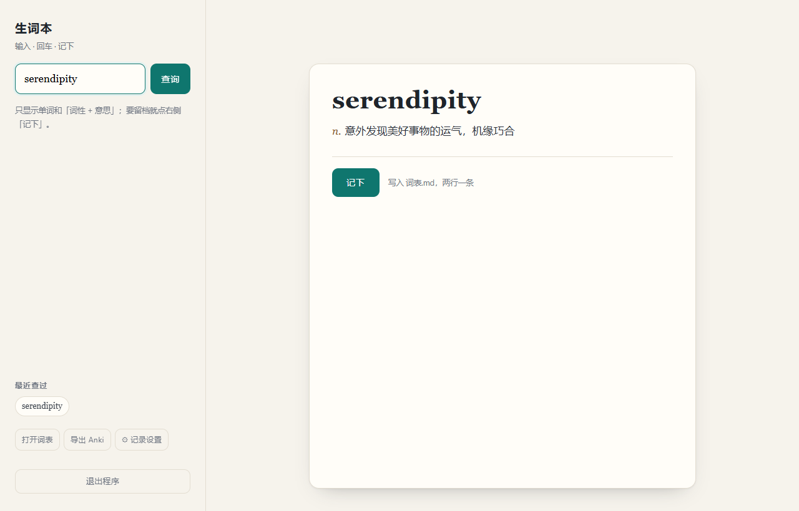
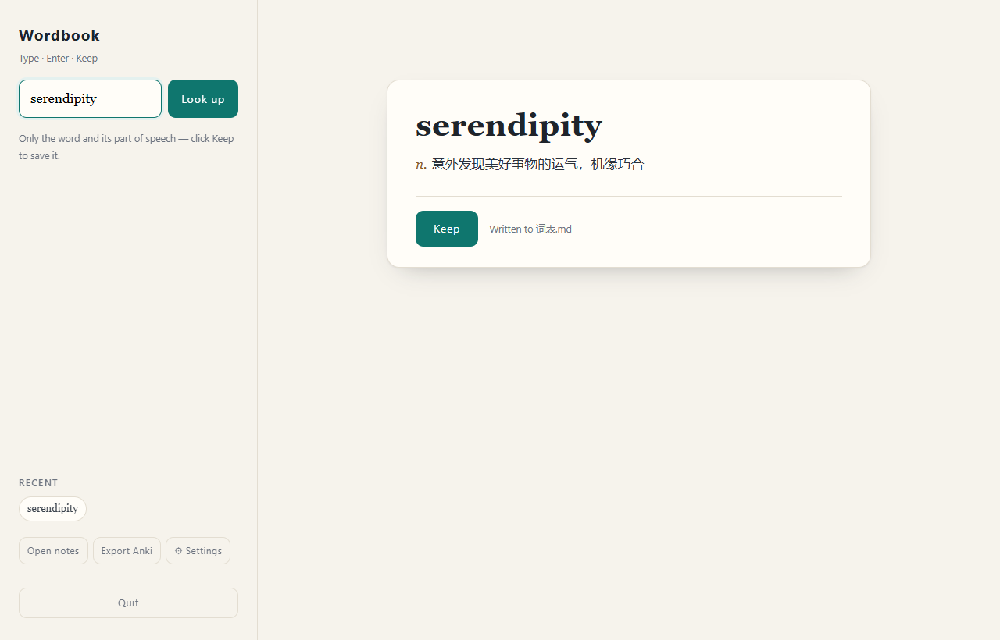

# 生词本 · Wordbook

**一个只跑在本机的极简生词本：左边查词，右边两行，点「记下」就写进桌面的纯文本文件。**

*A local-first English → Chinese vocabulary notebook for Windows. Zero dependencies, no account, no cloud.*

**简体中文** | [English](README.en.md)

[](https://github.com/MSaknussemm/wordbook/actions/workflows/ci.yml)
[](LICENSE)
[](https://www.python.org/)
[](#环境)

| 中文界面 | English UI |
|---|---|
|  |  |

---

## 为什么做这个

市面上的背单词软件太重，词典工具又要么只做划词、要么逼你上云。我想要的很窄：

- 读到不认识的词，**查一下**；
- 觉得值得记，**点一下**，它就变成 `词表.txt` 里的一条；
- 不想记的，查多少次都不留痕。

没有账号、没有同步、没有复习算法、没有推荐。就是一个查词框加一个文本文件。

## 特性

| | |
|---|---|
| **两行，默认克制** | 第一行单词，第二行「词性 + 意思」。音标、例句这些东西默认**不出现** |
| **中英双语界面** | 设置里切「跟随系统 / 中文 / English」，即时生效；**词表里的标签**也跟着变 |
| **双词典源** | 先问有道（中文释义），失败或未收录时自动退回 Wiktionary（英文） |
| **记录可调** | 三档预设（极简 / 学习卡 / 全量）+ 逐项勾选 + `{{word}} {{pos}} {{zh}} …` 自定义模板 |
| **不重复** | 同一个词只记一次，重复点会提示「已在词表里」 |
| **能撤销** | 记错了当场撤；如果你之后手动改过词表，它会**拒绝**而不是乱截 |
| **能带走** | 导出 Anki CSV（两列：单词、释义；带 BOM，Excel 不乱码） |
| **无黑窗口** | 桌面快捷方式 → `pythonw` 后台启动，全程没有控制台窗口 |
| **自己会退** | 关掉标签页 15 秒后自动退出，不留孤儿进程 |
| **本地安全** | 只监听 `127.0.0.1`；POST 校验 `Host` / `Origin` / `Sec-Fetch-Site`，挡跨站与 DNS rebinding |

## 环境

- **Windows 10 / 11**（用到 `winreg`、`SO_EXCLUSIVEADDRUSE`、VBS、PowerShell，不跨平台）
- **Python 3.10+**（用了 `dict[str, ...]`、`str | None`）
- **不需要 `pip install` 任何东西**——纯标准库，这是项目的硬约束

## 快速开始

```powershell
git clone https://github.com/MSaknussemm/wordbook.git
cd wordbook
```

1. 把目录放到任意位置（示例：`C:\生词本`）
2. 右键 `启动词本.vbs` → **发送到** → **桌面快捷方式**
3. 想换图标：右键快捷方式 → 属性 → 更改图标 → 选 `生词本.ico`
4. 双击桌面图标，浏览器会自己打开

词表默认写到 `桌面\词表.txt`。想换位置：

```powershell
python wordbook.py --file "D:\notes\我的生词.md"
```

## 用法

| 操作 | 说明 |
|---|---|
| `回车` | 查询 |
| `Ctrl + D` | 记下当前词 |
| `↑` / `↓` | 光标不在输入框时，翻「最近查过」 |
| `Esc` | 清空输入框 |
| `⚙ 记录设置` | 选字段 / 模板 / **界面语言** |
| `撤销上一条` | 撤掉刚记的那条 |
| `打开词表` | 用系统默认程序打开 `词表.txt` |
| `导出 Anki` | 下载 CSV |

## 记成什么样

默认只有两行：

```text
serendipity
n. 意外发现美好事物的运气，机缘巧合
```

打开「学习卡」预设后：

```text
ephemeral
adj. 短暂的；（主指植物）短生的，短命的；n. 只生存一天的事物；短生植物
音标：UK /ɪˈfemərəl/ · US /ɪˈfemərəl/
例句：
  He talked about the country's ephemeral unity being shattered by the defeat.
  他谈到战败彻底粉碎了国家的短暂统一。
```

自定义模板（`⚙ 记录设置` → 模板框）：

```text
{{word}}	{{pos}}	{{zh}}
```

可用占位符：`{{word}} {{pos}} {{zh}} {{en}} {{phonetic}} {{examples}} {{forms}} {{exam}} {{web}} {{time}}`。
带空格也认（`{{ word }}`）。词条第一行必须是单词（漏了程序会补），判重和导出靠它。

## 运行时文件

| 路径 | 作用 |
|---|---|
| `桌面\词表.txt` | 你的词表（纯文本，随便备份） |
| `%LOCALAPPDATA%\Wordbook\config.json` | 记录设置（字段 / 模板） |
| `%LOCALAPPDATA%\Wordbook\port.txt` | 当前真实端口（每 5 秒重写，退不删） |

删掉 `config.json` 即恢复默认（极简两行）。

## 它是怎么跑的

```
双击快捷方式
  → 启动词本.vbs 读 port.txt
  → 没有活着的实例就 pythonw wordbook.py --no-browser
  → 后端绑定端口，把真实端口写回 port.txt
  → 启动器校验 /api/ping 的 app 字段后打开浏览器
  → 页面挂一条 SSE 长连接 + 20 秒心跳
  → 关标签 15 秒 / 心跳停 90 秒 / 启动后 60 秒无人连 → 自动退出
```

为什么是三条判据而不是「关标签就退」：

- 只认 `pagehide` 会被 **F5 刷新**误杀（刷新也触发它）；
- 只认心跳会被**浏览器后台节流**误杀（后台定时器被压到每分钟一次）；
- 只认 SSE 连接会被**半开连接**骗（Wi-Fi 断了，服务器还以为有人挂着）。

所以：SSE 判「快」，心跳判「慢」，启动宽限判「从来没人来」。另外看门狗发现时间跳了 10 秒以上会判定「刚从睡眠回来」，把心跳拨正——**合盖睡眠不会误杀**。

## 安全

- 服务只监听 `127.0.0.1`，不对局域网/外网开放
- POST 接口校验 `Sec-Fetch-Site` 与 `Origin`，并把 `Host` 钉死为 `127.0.0.1:<port>` / `localhost:<port>`（挡 DNS rebinding）
- 监听端用 `SO_EXCLUSIVEADDRUSE` 独占端口，第二个实例会绑定失败
- 前端一律 `textContent`，不拼 HTML
- 导出 CSV 时对 `= + - @` 开头的单元格加 `'`，防公式注入
- 撤销前校验「文件长度 + 文件尾部」与写入记录一致，不一致就拒绝

细节见 [SECURITY.md](SECURITY.md)。

## 词典来源与免责声明

- 有道 `dict.youdao.com/jsonapi_s` 是**非官方**公开接口，没有 SLA，可能随时变更或失效。请控制请求频率，仅用于个人学习。
- 英文兜底来自 [dictionaryapi.dev](https://dictionaryapi.dev)（Wiktionary，CC BY-SA）。
- 本项目**不附带任何词典数据**，释义在查询时实时获取；词表只存在你本机。
- 与上述服务无任何关联。如需稳定的中文释义，建议自行接入官方 API。

## 开发

```powershell
python -m unittest discover -s tests -v   # 26 个测试，纯离线
python wordbook.py --version
```

测试覆盖：输入校验、词条生成（字段开关 / 模板 / 多词性）、CSV 导出与注入防护、撤销的三重校验、`Host`/`Origin` 判定、端口探测与独占绑定。

CI 在 Windows 上跑 Python 3.10 / 3.11 / 3.12 三档。贡献前请看 [CONTRIBUTING.md](CONTRIBUTING.md)。

## 目录结构

```
wordbook/
├─ wordbook.py              # 后端：查词、解析、写纯文本词表、自动退出
├─ index.html               # 前端：左右分栏、查询、记下、设置
├─ 启动词本.vbs              # 无窗口启动器（快捷方式指向它）
├─ 启动词本(排错用).bat       # 带黑窗口启动，出问题看报错
├─ 停止词本.bat              # 强制关闭后台服务
├─ stop.ps1                 # 停止脚本的逻辑本体
├─ 生词本.ico                # 图标
├─ 使用说明.md               # 面向使用者的中文说明
├─ tests/test_wordbook.py   # 单元测试
├─ assets/                  # README 用的图片
└─ .github/                 # CI、Issue / PR 模板
```

## 已知限制

- **仅 Windows**。要跨平台得重写启动器和端口独占逻辑。
- **Anki 导出只有两列**（单词、释义）。音标和例句不会导出——那是给背诵用的最小集合，不是词表镜像。
- **依赖非官方接口**，随时可能失效；失效时会退到 Wiktionary（只有英文）。
- `pick_port` 只在 8765~8784 之间找端口；全被占会直接报错。
- 「最近查过」存在浏览器 `localStorage`，换浏览器或清缓存会丢。

## 相关文档

- [使用说明.md](使用说明.md) —— 面向使用者的完整操作说明
- [README.en.md](README.en.md) —— English
- [CONTRIBUTING.md](CONTRIBUTING.md) —— 怎么贡献、代码约定
- [SECURITY.md](SECURITY.md) —— 安全策略与漏洞报告
- [CODE_OF_CONDUCT.md](CODE_OF_CONDUCT.md) —— 行为准则
- [CHANGELOG.md](CHANGELOG.md) —— 更新日志

## License

代码以 [MIT](LICENSE) 许可发布；词典内容版权归各自来源所有。
